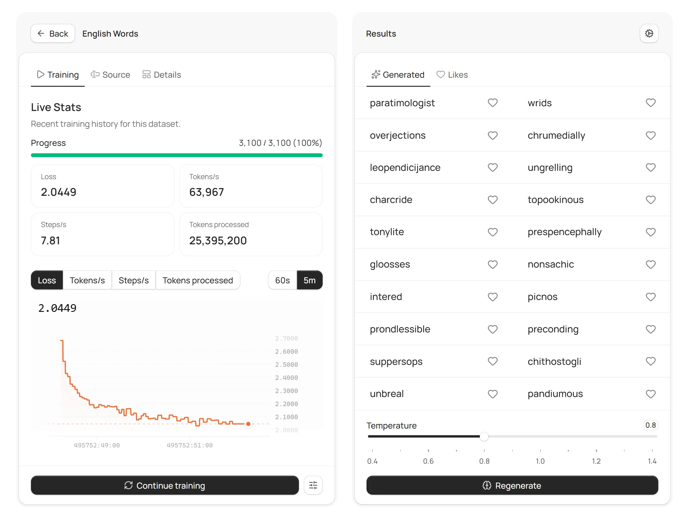

# Train GPT in Browser

Train a character-level GPT on newline-delimited text using TensorFlow.js. The app runs training in a Web Worker, uses WebGPU when available, and falls back to CPU. An Electron desktop app is also included.

[Demo](https://cpauldev.github.io/train-gpt-in-browser/) · [Desktop releases](https://github.com/cpauldev/train-gpt-in-browser/releases) · [Python counterpart](https://github.com/cpauldev/character-level-transformer)



## Getting started

Requires Node.js 22.12 or later and Bun 1.4.4, as specified in `package.json`.

```sh
bun install --frozen-lockfile
bun run dev
```

Open `http://localhost:5173`.

## Usage

1. Choose a bundled dataset or upload a plain-text `.txt` file.
2. Edit the dataset and configure training in the editor.
3. Start training, then generate samples, adjust temperature and save liked results.

Each non-empty line is a training sample; leading and trailing whitespace is trimmed. Continuing a run uses its latest checkpoint. Starting fresh replaces the saved run for that dataset.

### Datasets

| File | Non-empty lines |
| --- | ---: |
| [`public/datasets/english_words.txt`](public/datasets/english_words.txt) | 370,105 |
| [`public/datasets/us_baby_names.txt`](public/datasets/us_baby_names.txt) | 104,819 |

### Storage and exports

Datasets, runs, checkpoints and results are stored locally in IndexedDB. Exported `.model` files contain an ONNX graph, tokenizer and source-filter metadata compatible with the Python counterpart's JavaScript bundle runner. Exports are cached in OPFS when available, with an IndexedDB fallback.

Generation uses a Bloom filter to reject source-line matches. False positives can reject novel strings, and accepted outputs are not a guarantee of real-world originality.

Resetting local data removes saved workspace data and restores the bundled datasets. Export files downloaded to your computer are separate from browser storage.

## Desktop app

```sh
bun run desktop:dev
```

Build an unpacked app or installer for the current platform:

```sh
bun run desktop:pack
bun run desktop:dist
```

The release workflow targets Windows x64, macOS x64/arm64 and Linux x64. Published downloads are listed on the [releases page](https://github.com/cpauldev/train-gpt-in-browser/releases).

To check a built archive:

```sh
bun run desktop:smoke path/to/app.asar
```

On Windows, the default path is `release/win-unpacked/resources/app.asar`. The smoke check opens a hidden window with an isolated profile and checks the renderer, bundled datasets and preload bridge.

## Development

```sh
bun run validate
```

This runs code and Markdown checks, TypeScript checks, tests, unused-code checks and the production build. Use `bun run test` for tests in watch mode.

The desktop shell currently imports only Electron and Node.js built-ins; renderer dependencies are bundled by Vite. If the shell gains a runtime package dependency, update the packaging rules that exclude `node_modules`.

## License

[MIT](LICENSE).
